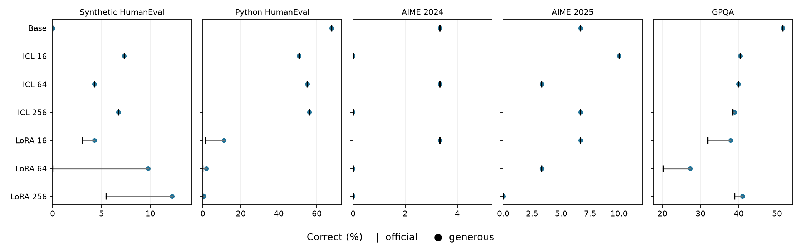
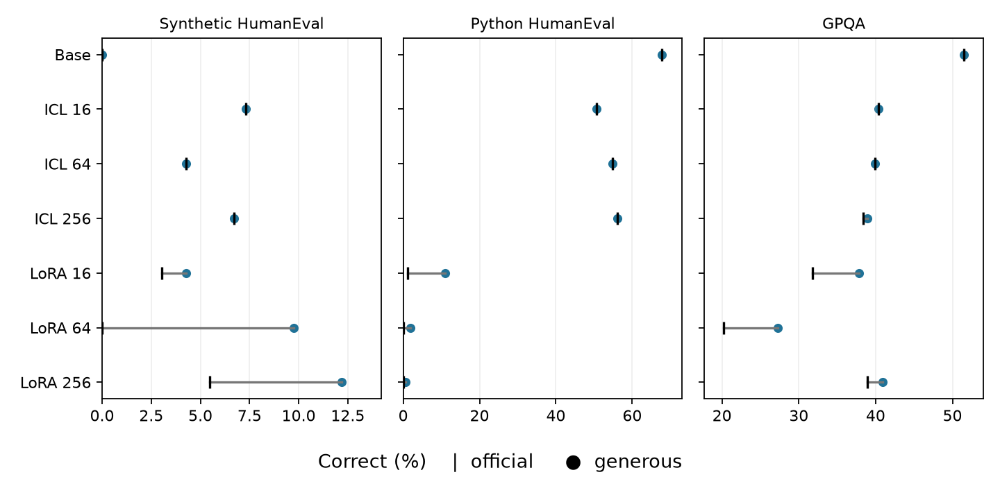
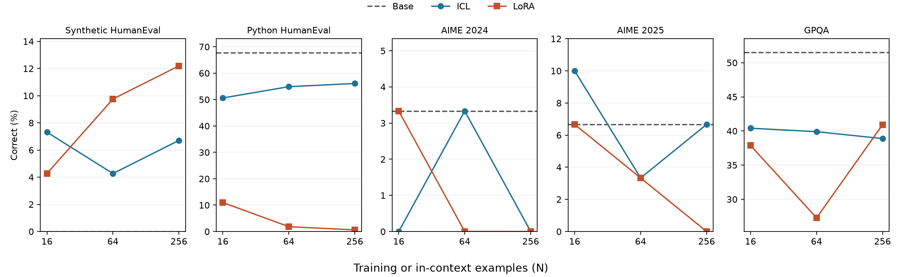
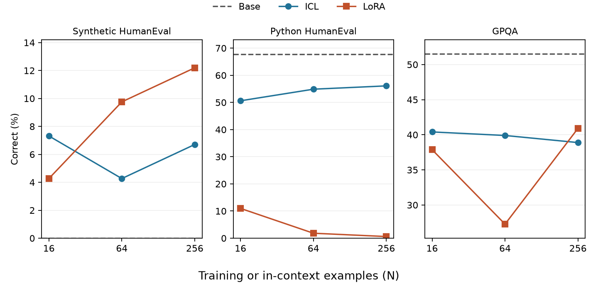

# Seed 0 with a more permissive answer parser

All seven conditions cover the same 586 benchmark prompts (4,102 evaluations). This is a sensitivity analysis on saved generations, including saved retries. Raw outputs and official scores are preserved. Each table cell below gives the new count, percentage and additional tasks recovered over the official results.

## Findings

**LoRA overtakes ICL on synthetic HumanEval at N=64 and N=256 under permissive scoring.** At N=16 ICL still leads 12 to 7. At N=64 LoRA leads 16 to 7, and at N=256 it leads 20 to 11. All 29 additional synthetic solves came from extracting existing code that passed the tests without inserting a definition keyword. At N=256 only two synthetic tasks were solved by both methods: LoRA solved 18 others and ICL solved nine others.

**Ordinary Python retention remains much stronger for ICL.** At N=16 LoRA rises from 2 to 18 solves, with 13 of its 16 gains requiring a missing definition keyword. At N=256, 54 LoRA submissions contain a usable function under the new rules but only one passes, versus 92 passes for ICL and 111 for base. Recovering a callable function and recovering a correct algorithm produce very different estimates.

**GPQA format compliance explained some of the apparent loss.** LoRA N=16 gains 33 readable choices and 12 correct answers; N=64 gains 34 and 14. At N=256 LoRA and ICL each supply 197 readable choices and score 81 and 77 correct, respectively. Base remains ahead at 102. Neither AIME year gains a correct solution under these rules. Each year contains only 30 tasks.

**Across all conditions**, 478 formerly invalid submissions became readable and 80 became correct (79 LoRA and one ICL). Of 385 recovered code submissions, 49 passed. Four of the 80 additional correct answers came from an earlier draft after a retry. Despite the change on synthetic code, the pooled ranking still favors base (216 solves), followed by the ICL configurations (178–182) and the LoRA configurations (74–103). These are paired observations from one seed.

## Correct answers

| Condition | Synthetic HumanEval | Python HumanEval | AIME 2024 | AIME 2025 | GPQA | Pooled |
|---|---|---|---|---|---|---|
| Base | 0/164 · 0.0% (+0) | 111/164 · 67.7% (+0) | 1/30 · 3.3% (+0) | 2/30 · 6.7% (+0) | 102/198 · 51.5% (+0) | 216/586 · 36.9% (+0) |
| ICL 16 | 12/164 · 7.3% (+0) | 83/164 · 50.6% (+0) | 0/30 · 0.0% (+0) | 3/30 · 10.0% (+0) | 80/198 · 40.4% (+0) | 178/586 · 30.4% (+0) |
| ICL 64 | 7/164 · 4.3% (+0) | 90/164 · 54.9% (+0) | 1/30 · 3.3% (+0) | 1/30 · 3.3% (+0) | 79/198 · 39.9% (+0) | 178/586 · 30.4% (+0) |
| ICL 256 | 11/164 · 6.7% (+0) | 92/164 · 56.1% (+0) | 0/30 · 0.0% (+0) | 2/30 · 6.7% (+0) | 77/198 · 38.9% (+1) | 182/586 · 31.1% (+1) |
| LoRA 16 | 7/164 · 4.3% (+2) | 18/164 · 11.0% (+16) | 1/30 · 3.3% (+0) | 2/30 · 6.7% (+0) | 75/198 · 37.9% (+12) | 103/586 · 17.6% (+30) |
| LoRA 64 | 16/164 · 9.8% (+16) | 3/164 · 1.8% (+3) | 0/30 · 0.0% (+0) | 1/30 · 3.3% (+0) | 54/198 · 27.3% (+14) | 74/586 · 12.6% (+33) |
| LoRA 256 | 20/164 · 12.2% (+11) | 1/164 · 0.6% (+1) | 0/30 · 0.0% (+0) | 0/30 · 0.0% (+0) | 81/198 · 40.9% (+4) | 102/586 · 17.4% (+16) |

## Valid outputs

| Condition | Synthetic HumanEval | Python HumanEval | AIME 2024 | AIME 2025 | GPQA | Pooled |
|---|---|---|---|---|---|---|
| Base | 22/164 · 13.4% (+5) | 159/164 · 97.0% (+6) | 24/30 · 80.0% (+0) | 27/30 · 90.0% (+0) | 198/198 · 100.0% (+0) | 430/586 · 73.4% (+11) |
| ICL 16 | 67/164 · 40.9% (+0) | 150/164 · 91.5% (+2) | 24/30 · 80.0% (+0) | 29/30 · 96.7% (+0) | 197/198 · 99.5% (+0) | 467/586 · 79.7% (+2) |
| ICL 64 | 55/164 · 33.5% (+0) | 159/164 · 97.0% (+1) | 27/30 · 90.0% (+0) | 29/30 · 96.7% (+0) | 197/198 · 99.5% (+0) | 467/586 · 79.7% (+1) |
| ICL 256 | 67/164 · 40.9% (+0) | 160/164 · 97.6% (+2) | 25/30 · 83.3% (+0) | 30/30 · 100.0% (+0) | 197/198 · 99.5% (+5) | 479/586 · 81.7% (+7) |
| LoRA 16 | 14/164 · 8.5% (+4) | 89/164 · 54.3% (+81) | 9/30 · 30.0% (+0) | 8/30 · 26.7% (+2) | 173/198 · 87.4% (+33) | 293/586 · 50.0% (+120) |
| LoRA 64 | 108/164 · 65.9% (+107) | 57/164 · 34.8% (+50) | 6/30 · 20.0% (+1) | 8/30 · 26.7% (+3) | 147/198 · 74.2% (+34) | 326/586 · 55.6% (+195) |
| LoRA 256 | 115/164 · 70.1% (+75) | 54/164 · 32.9% (+52) | 18/30 · 60.0% (+4) | 15/30 · 50.0% (+1) | 197/198 · 99.5% (+10) | 399/586 · 68.1% (+142) |

For HumanEval, validity means a parsable top-level definition with the requested name; correctness requires passing the original tests. On synthetic HumanEval the program still has to decode under the seeded dialect. For GPQA and AIME, validity means a recoverable single choice or integer; correctness is exact match. The pooled rates count both HumanEval variants and weight benchmarks by their numbers of prompts.

## Paired task comparisons

Each cell is gains / losses going from the first condition to the second under the generous parser, on identical benchmark and task IDs.

| Comparison | Synthetic HumanEval | Python HumanEval | AIME 2024 | AIME 2025 | GPQA |
|---|---|---|---|---|---|
| Base → ICL 16 | 12 / 0 | 8 / 36 | 0 / 1 | 2 / 1 | 26 / 48 |
| Base → ICL 64 | 7 / 0 | 13 / 34 | 0 / 0 | 0 / 1 | 27 / 50 |
| Base → ICL 256 | 11 / 0 | 13 / 32 | 0 / 1 | 1 / 1 | 22 / 47 |
| Base → LoRA 16 | 7 / 0 | 4 / 97 | 1 / 1 | 1 / 1 | 29 / 56 |
| Base → LoRA 64 | 16 / 0 | 1 / 109 | 0 / 1 | 0 / 1 | 17 / 65 |
| Base → LoRA 256 | 20 / 0 | 0 / 110 | 0 / 1 | 0 / 2 | 25 / 46 |
| ICL 16 → LoRA 16 | 5 / 10 | 7 / 72 | 1 / 0 | 2 / 3 | 34 / 39 |
| ICL 64 → LoRA 64 | 11 / 2 | 0 / 87 | 0 / 1 | 0 / 0 | 23 / 48 |
| ICL 256 → LoRA 256 | 18 / 9 | 0 / 91 | 0 / 0 | 0 / 2 | 39 / 35 |
| ICL 16 → ICL 64 | 6 / 11 | 22 / 15 | 1 / 0 | 0 / 2 | 31 / 32 |
| ICL 64 → ICL 256 | 7 / 3 | 30 / 28 | 0 / 1 | 1 / 0 | 35 / 37 |
| ICL 16 → ICL 256 | 9 / 10 | 27 / 18 | 0 / 0 | 1 / 2 | 32 / 35 |
| LoRA 16 → LoRA 64 | 12 / 3 | 0 / 15 | 0 / 1 | 1 / 2 | 29 / 50 |
| LoRA 64 → LoRA 256 | 12 / 8 | 1 / 3 | 0 / 0 | 0 / 1 | 53 / 26 |
| LoRA 16 → LoRA 256 | 17 / 4 | 0 / 17 | 0 / 1 | 0 / 2 | 39 / 33 |

## What the parser recovered

| Extraction rule | Additional valid | Additional correct |
|---|---|---|
| extract code | 221 | 33 |
| final standalone | 2 | 0 |
| insert definition keyword | 164 | 16 |
| leading integer | 6 | 0 |
| leading option | 69 | 26 |
| marked answer | 16 | 5 |

## Retry and draft sensitivity

When a retry was present, it received priority. The rightmost column isolates gains from revisiting the initial draft after the retry supplied no identifiable submission. All columns count additional correct answers.

| Condition | Single attempt | From retry | From earlier draft |
|---|---|---|---|
| Base | 0 | 0 | 0 |
| ICL 16 | 0 | 0 | 0 |
| ICL 64 | 0 | 0 | 0 |
| ICL 256 | 1 | 0 | 0 |
| LoRA 16 | 11 | 15 | 4 |
| LoRA 64 | 21 | 12 | 0 |
| LoRA 256 | 12 | 4 | 0 |

## Scoring rules and limits

- This is an additive rescoring. Originally valid responses keep their score, including valid but incorrect answers. Extraction rules only operate on previously invalid responses. The same rules apply to base, ICL and LoRA.
- The parser can use text with missing thinking boundaries, ignores common boundary tokens and searches final segments first. Extra reasoning can surround a submission. If a retry has no identifiable submission, it can use the initial draft. A recognized but malformed code candidate blocks fallback; a failed test never triggers a second candidate.
- GPQA accepts explicit choice phrases, boxed choices, a final standalone letter, a leading choice with commentary, or exactly one matching option text. Guards on the leading-choice rule exclude competing option labels and reconsideration language. AIME also accepts a leading standalone integer. A bare intermediate equation cannot supply an answer. Earlier text segments and superseded drafts can supply a short answer only with a final marked answer line.
- For code, the parser favors the last identified submission with the requested signature, tolerates prose or Markdown around it, and can restore an omitted definition keyword on a signature matching the required name. It does not fix an algorithm, synthesize imports, close arbitrary brackets, or convert plain Python into synthetic code. Extraction uses neither the answer key nor the unit tests to choose a candidate.
- Recovered code is executed locally using the project's isolated HumanEval scorer and 10-second timeout. Original executions retain their original platform. Base ran locally, ICL on the server, and LoRA N=16 combines Colab and local rows. Server and local FP16 model files have different checksums. These seed-0 comparisons do not establish effects across seeds.

## Reproduction

From the repository root, run the project Python on [rescore.py](rescore.py) and then [report.py](report.py). [scores.jsonl](scores.jsonl) records the strict and generous outcomes per original key, the extraction rule and attempt, and the recovered code or answer where applicable. [Official analysis](../seed-0.md).
