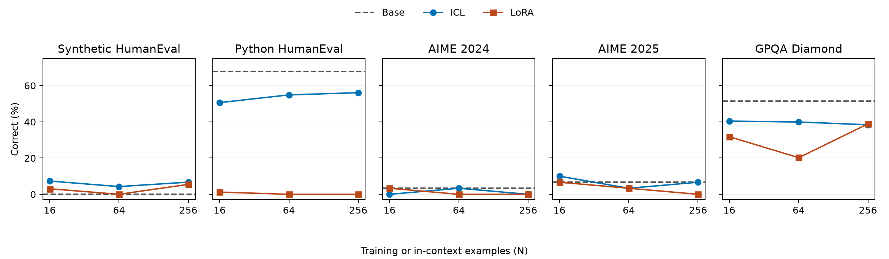

# Seed 0 · ICL, LoRA and the base model

Seed 0 is complete. Each condition answered the same 586 benchmark prompts with one sample per task. The comparison contains 4,102 unique evaluations. The two HumanEval variants reuse the same 164 underlying problems. ICL received nested example sets in its prompt; LoRA received the corresponding training examples through adapter training.

**ICL solved more synthetic tasks than LoRA at all three sizes and retained more ordinary Python performance.** At N=16, synthetic HumanEval went from 0/164 for base to 12/164 for ICL and 5/164 for LoRA. At N=256, the synthetic gap narrowed to two solves (11 versus 9), but ordinary Python still separated the methods by 92 solves (92 versus 0). The base model led on ordinary Python and GPQA. No method consistently improved AIME across the two years.

## Correct answers

Each cell gives correct / evaluated and the percentage. For HumanEval, correct means all execution tests passed. For AIME and GPQA it means the extracted answer matched the reference. The pooled column weights each benchmark row equally, so GPQA and the two programming variants dominate.

| Condition | Synthetic HumanEval | Python HumanEval | AIME 2024 | AIME 2025 | GPQA Diamond | Pooled |
|---|---|---|---|---|---|---|
| Base | 0/164 (0.0%) | 111/164 (67.7%) | 1/30 (3.3%) | 2/30 (6.7%) | 102/198 (51.5%) | 216/586 (36.9%) |
| ICL 16 | 12/164 (7.3%) | 83/164 (50.6%) | 0/30 (0.0%) | 3/30 (10.0%) | 80/198 (40.4%) | 178/586 (30.4%) |
| ICL 64 | 7/164 (4.3%) | 90/164 (54.9%) | 1/30 (3.3%) | 1/30 (3.3%) | 79/198 (39.9%) | 178/586 (30.4%) |
| ICL 256 | 11/164 (6.7%) | 92/164 (56.1%) | 0/30 (0.0%) | 2/30 (6.7%) | 76/198 (38.4%) | 181/586 (30.9%) |
| LoRA 16 | 5/164 (3.0%) | 2/164 (1.2%) | 1/30 (3.3%) | 2/30 (6.7%) | 63/198 (31.8%) | 73/586 (12.5%) |
| LoRA 64 | 0/164 (0.0%) | 0/164 (0.0%) | 0/30 (0.0%) | 1/30 (3.3%) | 40/198 (20.2%) | 41/586 (7.0%) |
| LoRA 256 | 9/164 (5.5%) | 0/164 (0.0%) | 0/30 (0.0%) | 0/30 (0.0%) | 77/198 (38.9%) | 86/586 (14.7%) |

## Valid outputs

For code, validity requires successful parsing (including dialect decoding where applicable) and a definition of the expected entry point. An executable answer can still fail tests. For AIME and GPQA, validity means the scorer extracted a final answer. Counts include final-answer retries.

| Condition | Synthetic HumanEval | Python HumanEval | AIME 2024 | AIME 2025 | GPQA Diamond |
|---|---|---|---|---|---|
| Base | 17/164 (10.4%) | 153/164 (93.3%) | 24/30 (80.0%) | 27/30 (90.0%) | 198/198 (100.0%) |
| ICL 16 | 67/164 (40.9%) | 148/164 (90.2%) | 24/30 (80.0%) | 29/30 (96.7%) | 197/198 (99.5%) |
| ICL 64 | 55/164 (33.5%) | 158/164 (96.3%) | 27/30 (90.0%) | 29/30 (96.7%) | 197/198 (99.5%) |
| ICL 256 | 67/164 (40.9%) | 158/164 (96.3%) | 25/30 (83.3%) | 30/30 (100.0%) | 192/198 (97.0%) |
| LoRA 16 | 10/164 (6.1%) | 8/164 (4.9%) | 9/30 (30.0%) | 6/30 (20.0%) | 140/198 (70.7%) |
| LoRA 64 | 1/164 (0.6%) | 7/164 (4.3%) | 5/30 (16.7%) | 5/30 (16.7%) | 113/198 (57.1%) |
| LoRA 256 | 40/164 (24.4%) | 2/164 (1.2%) | 14/30 (46.7%) | 14/30 (46.7%) | 187/198 (94.4%) |

On synthetic HumanEval, ICL produced 55–67 valid entries at every size but only 7–12 solves. LoRA at N=256 recovered to 40 valid entries and 9 solves. At N=64, 158/164 synthetic LoRA outputs missed the expected entry point; only one was valid, and it failed tests. Ordinary Python showed a separate loss: just 8, 7 and 2 valid LoRA entries as N increased. The loss begins before execution for most LoRA outputs.

On GPQA, base yielded 198 valid answers and 102 correct (51.5%). At N=256, ICL and LoRA finished one solve apart (76 versus 77) despite 192 versus 187 valid answers. LoRA N=64 produced only 113 valid GPQA answers. AIME has 30 problems per year, so one solve shifts a rate by 3.3 percentage points. Differences of one or two solves are weak evidence for a method ranking.

## Which tasks changed

Each cell is **gains / losses** when moving from the first condition to the second. A gain is a task only the second condition solved; a loss is a task only the first solved. Tasks are paired within benchmark by exact ID. Equal totals can hide substitutions.

| First → second | Synthetic HumanEval | Python HumanEval | AIME 2024 | AIME 2025 | GPQA Diamond |
|---|---|---|---|---|---|
| Base → ICL 16 | 12 / 0 | 8 / 36 | 0 / 1 | 2 / 1 | 26 / 48 |
| Base → ICL 64 | 7 / 0 | 13 / 34 | 0 / 0 | 0 / 1 | 27 / 50 |
| Base → ICL 256 | 11 / 0 | 13 / 32 | 0 / 1 | 1 / 1 | 21 / 47 |
| Base → LoRA 16 | 5 / 0 | 0 / 109 | 1 / 1 | 1 / 1 | 23 / 62 |
| Base → LoRA 64 | 0 / 0 | 0 / 111 | 0 / 1 | 0 / 1 | 11 / 73 |
| Base → LoRA 256 | 9 / 0 | 0 / 111 | 0 / 1 | 0 / 2 | 24 / 49 |
| ICL 16 → LoRA 16 | 3 / 10 | 1 / 82 | 1 / 0 | 2 / 3 | 30 / 47 |
| ICL 64 → LoRA 64 | 0 / 7 | 0 / 90 | 0 / 1 | 0 / 0 | 16 / 55 |
| ICL 256 → LoRA 256 | 8 / 10 | 0 / 92 | 0 / 0 | 0 / 2 | 36 / 35 |
| ICL 16 → ICL 64 | 6 / 11 | 22 / 15 | 1 / 0 | 0 / 2 | 31 / 32 |
| ICL 64 → ICL 256 | 7 / 3 | 30 / 28 | 0 / 1 | 1 / 0 | 35 / 38 |
| LoRA 16 → LoRA 64 | 0 / 5 | 0 / 2 | 0 / 1 | 1 / 2 | 24 / 47 |
| LoRA 64 → LoRA 256 | 9 / 0 | 0 / 0 | 0 / 0 | 0 / 1 | 58 / 21 |

At N=256, ICL and LoRA shared only one successful synthetic task: 10 were unique to ICL and 8 to LoRA. On GPQA their totals differed by one, yet they disagreed on 71 of 198 outcomes. Within ICL, increasing N from 64 to 256 gained 30 previously unsolved Python tasks and lost 28 previously solved ones. The net gain of two conceals that turnover.

## Generation limits and final-answer retries

Length caps refer to the initial generation. A capped coding response receives a final code attempt of up to 750 tokens. A capped AIME or GPQA response receives up to 25 tokens when its answer is missing. Gains and losses compare the initial score with the recorded final score on retried prompts. Average generated tokens include both attempts.

| Condition | Initial cap / 586 | Retried | Became valid | Became correct | Lost correct | Mean generated tokens |
|---|---|---|---|---|---|---|
| Base | 498 | 498 | 331 | 158 | 0 | 2067 |
| ICL 16 | 446 | 446 | 337 | 110 | 0 | 1893 |
| ICL 64 | 466 | 466 | 349 | 122 | 0 | 1936 |
| ICL 256 | 433 | 433 | 330 | 122 | 0 | 1856 |
| LoRA 16 | 433 | 429 | 64 | 20 | 0 | 1985 |
| LoRA 64 | 276 | 274 | 39 | 8 | 0 | 1264 |
| LoRA 256 | 330 | 330 | 136 | 34 | 0 | 1519 |

The final-answer step accounted for 158 of 216 base solves and 110–122 solves per ICL configuration. It recovered only 8 of the 274 retried LoRA N=64 prompts. That group also hit the initial cap less often than any other group. A longer final-answer budget alone would miss failures that ended before the cap.

## Interpretation and provenance

The intended 5–10% synthetic pass range was reached by ICL at N=16 (7.3%) and N=256 (6.7%), and by LoRA at N=256 (5.5%). ICL N=64 fell below the range (4.3%). This establishes seed 0 behavior only. The three training sizes reuse nested examples and repeated test IDs; their scores are paired observations. The result with the most synthetic solves used the smallest ICL example set.

Synthetic prompts exposed the mapped signature and explicit keyword hints to every method. For the retention benchmarks, ICL kept its synthetic demonstrations in context, while base and LoRA received the task without demonstrations. The measured retention therefore includes the practical effects of carrying those demonstrations into a new task.

Hardware and model artifacts vary with condition. Base ran locally on Metal; ICL ran on the NVIDIA server. Their model configurations, tokenizers and benchmark datasets agree, but their FP16 base-model weight files have different SHA-256 digests. Tensor-level equivalence is unverified. The 244 Colab LoRA N=16 rows (all 164 synthetic tasks and Python IDs 0–79) used the server-side weight-file digest. The other 342 N=16 rows and all N=64/256 LoRA rows used the local weight file. The N=16 adapter checksum matches across hosts. These differences limit attribution to adaptation alone. Processing speed is also confounded by hardware, concurrency, prompt length and retries.

The full-sweep report aggregates all available seeds and includes partial groups. Use this seed-specific report for paired comparisons until the other LoRA seeds finish. Source manifests and the Colab task list are under `../provenance/`; raw generations and both scoring attempts are in `../results.jsonl`.
